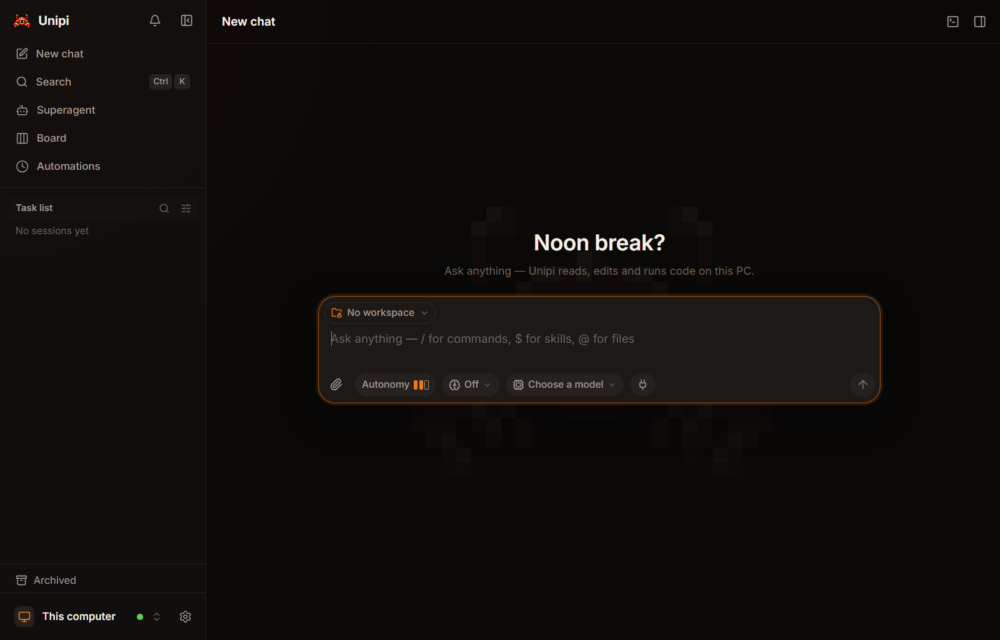
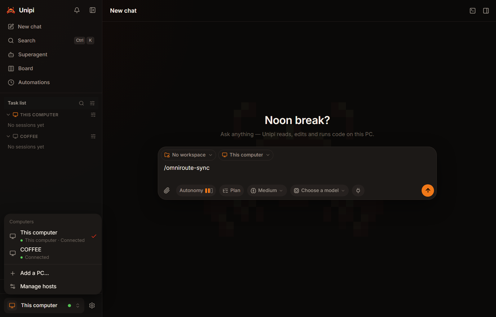
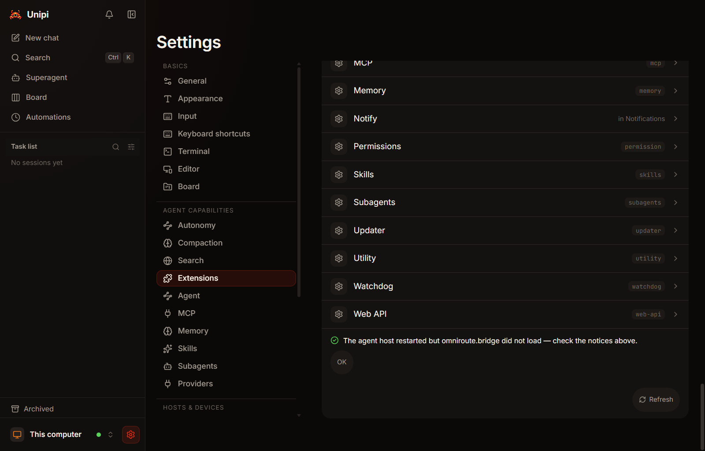
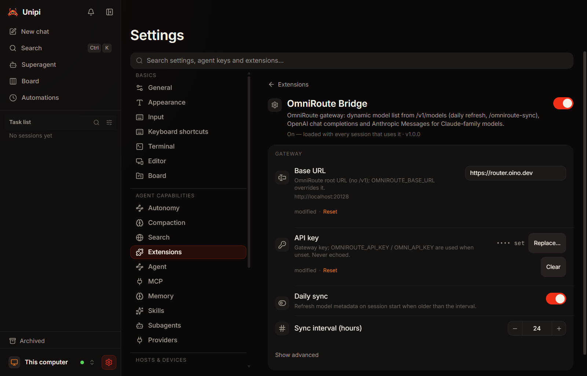
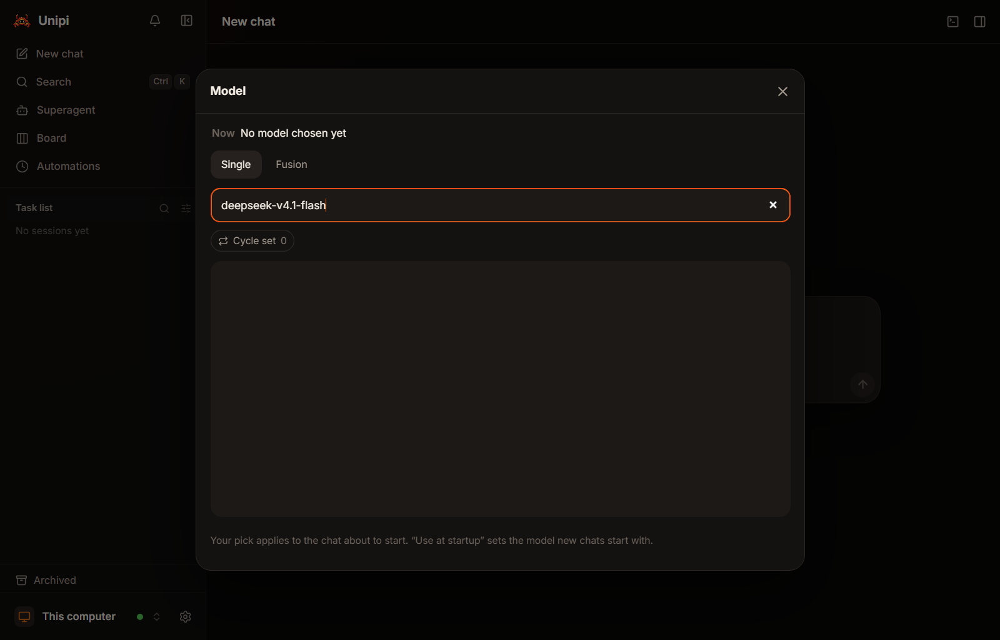

# Windows, WSL2, and Private Bridge Setup

This guide shows how to install the Unipi desktop app and Oino on Windows 11, connect or run inside WSL2, and set up the private `ors.bridge` and `omniroute.bridge` provider extensions.

Every step below is based on a clean Windows 11 verification run against release `v1.0.2` (2026-11-09). Where a step needs a workaround or is blocked by a known bug, this guide states that plainly.

Related docs: [Install and update](../install.md) · [Desktop and mobile](../desktop.md) · [Providers and credentials](../providers.md) · [Extensions](../extensions.md) · [Bundled unipi extensions](../unipi.md) · [Release update feeds](../release-feeds.md) · [Building Unipi](../../apps/unipi/BUILDING.md)

## 1. Choose a topology

### Which path should I pick?

| Path | Who it is for | Status in `v1.0.2` |
|---|---|---|
| **Path A — Native Windows app + built-in Windows host** | Normal Windows users whose repos live on NTFS (`C:\...`). | **Supported** with two UI workarounds: reload once on first launch (`OIN-58`) and fully quit/relaunch after installing an extension (`OIN-59`). Built-in providers work; private bridge chat is **blocked by `OIN-60`**. |
| **Path B — Windows app + paired WSL2 Linux host** | Developers who want the Windows GUI while tools, shells, and git run inside WSL2 Linux. | **Verified working** by pairing the WSL2 host over iroh as a separate PC (`unipi-oino-host pair` → **Add a PC** → **Paste pairing link**). Automatic local WSL adoption does not exist yet ([plan only](../dev/v2/specs/wsl-host-plan.md)). Private bridge chat is **blocked by `OIN-60`**. |
| **Path C — WSL-only CLI and headless host** | Terminal-first or headless users working inside WSL2. | CLI (`oino`), host (`unipi-oino-host`), and a `systemd --user` service **work**. CLI `.zip` extension install requires extracting the archive first (`OIN-61`). Headless chat through the private bridges **fails** with `No models available` (`OIN-60`). |

Current limitations across all three paths in `v1.0.2`:

- **No live `ors/*` or `omniroute/*` chat yet (`OIN-60`):** Both private bridges install and load, and **OmniRoute Bridge** accepts and masks your API key, but neither bridge populates models in the picker or CLI on a fresh install. Live ORS key entry and ORS chat were also not tested in the `v1.0.2` verification run. Use a built-in provider ([../providers.md](../providers.md)) until `OIN-60` is fixed.
- **No automatic "This computer" WSL mode:** Path B connects to WSL2 as a second paired computer (for example, `COFFEE Connected`), not as `This computer`.

---

## 2. Prerequisites

### Path A (Native Windows desktop app)

- **Windows 11 (x64).**
- **Microsoft Edge WebView2 Runtime** (preinstalled on Windows 11; verified with `157.0.4341.42`). The installer config does not embed an offline WebView2 bootstrapper.
- **Microsoft Visual C++ 2015–2022 Redistributable (x64)** (verified with `14.44.35211.0`).

### Path B and Path C (WSL2)

- Everything in Path A if you also run the Windows desktop app (Path B).
- **Windows optional features enabled:** `Microsoft-Windows-Subsystem-Linux` and `VirtualMachinePlatform` (requires one reboot).
- **WSL2 runtime and Ubuntu** (verified with WSL `3.0.3` and Ubuntu `26.04.1 LTS`).
- **`systemd` enabled inside WSL2** (`/etc/wsl.conf` containing `[boot]` and `systemd=true`, which is the default on current Ubuntu WSL images) if you want the background `systemd --user` host service. Without `systemd`, run `unipi-oino-host serve` manually in a terminal.
- **`python3` or `unzip`** inside WSL2 to unpack private `.zip` extension archives (`OIN-61`).

### Building from source only (optional)

Skip these if you install from GitHub Releases:

- Rust toolchain matching `rust-toolchain.toml`, plus the `wasm32-wasip2` target.
- Node.js 22 or newer and `npm`.
- Tauri CLI v2 (`cargo install tauri-cli --version ^2`).
- Visual Studio 2022 C++ Build Tools (MSVC `x86_64-pc-windows-msvc`).

---

## 3. Install UniPi Oino

Published releases live at `https://github.com/Neuron-Mr-White/Oino/releases`. Key release assets:

- `UniPi_<ver>_x64-setup.exe` — Windows per-user NSIS desktop installer (includes the built-in Windows host sidecar).
- `unipi-oino-host-<ver>-x86_64-unknown-linux-musl.tar.gz` — static Linux host + `oino` CLI + bundled extensions (for WSL2 Path B and Path C).
- `oino-<ver>-x86_64-unknown-linux-musl.tar.gz` — static Linux `oino` CLI + bundled extensions only (for Path C when you do not need `unipi-oino-host`).
- `install.ps1` and `install.sh` — scripted installers ([../install.md](../install.md)).
- `SHA256SUMS` — SHA-256 digests for every release asset. Update channels are documented in [../release-feeds.md](../release-feeds.md).

### 3.1 Path A (and Path B Windows side): Install the Windows desktop app

`UniPi_<ver>_x64-setup.exe` is **not** Authenticode code-signed (`Get-AuthenticodeSignature` returns `NotSigned`). Windows SmartScreen may warn before launching it. Always verify the SHA-256 hash against `SHA256SUMS` first.

1. Download `SHA256SUMS` and `UniPi_<ver>_x64-setup.exe` in PowerShell, then compare the SHA-256 hash:

   ```powershell
   $ver = "1.0.2"
   $base = "https://github.com/Neuron-Mr-White/Oino/releases/download/v$ver"
   Invoke-WebRequest "$base/SHA256SUMS" -OutFile SHA256SUMS
   Invoke-WebRequest "$base/UniPi_${ver}_x64-setup.exe" -OutFile "UniPi_${ver}_x64-setup.exe"
   (Get-FileHash ".\UniPi_${ver}_x64-setup.exe" -Algorithm SHA256).Hash.ToLower()
   Select-String -Path .\SHA256SUMS -Pattern "UniPi_${ver}_x64-setup.exe"
   ```

   Expected: Both outputs show the exact same 64-character hex digest (for `v1.0.2`, `3a8d3755accbe543439dbec09a43f22820ff5700522b79edadca6b55924ea8d4`). Do not run the file if the hashes differ.

2. Run the NSIS installer (per-user install, no administrator prompt required):

   ```powershell
   .\UniPi_1.0.2_x64-setup.exe
   ```

   Step through the wizard with the default install folder (`%LOCALAPPDATA%\UniPi Oino`). (For a silent scripted install, download `install.ps1`, verify it against `SHA256SUMS`, and run `.\install.ps1 -App`; for a headless Windows-only host logon task, see `-HostInstall` in [../install.md](../install.md).)

   Expected: The wizard starts at `Setup will guide you through the installation of UniPi Oino.`, completes with `Setup was completed successfully.`, and ends on `UniPi Oino has been installed on your computer.`

### 3.2 Path B and Path C: Install WSL2 and Ubuntu

Skip to section 3.3 if WSL2 and a Linux distro are already running (`wsl --list --verbose`).

1. Open **PowerShell as Administrator**, enable both required Windows features, and reboot:

   ```powershell
   Enable-WindowsOptionalFeature -Online -FeatureName Microsoft-Windows-Subsystem-Linux -NoRestart
   Enable-WindowsOptionalFeature -Online -FeatureName VirtualMachinePlatform -NoRestart
   Restart-Computer
   ```

   Expected: After Windows restarts, `Get-WindowsOptionalFeature -Online -FeatureName Microsoft-Windows-Subsystem-Linux,VirtualMachinePlatform` shows `State : Enabled` for both features.

2. Install the WSL2 runtime and Ubuntu from a regular or Administrator PowerShell window:

   ```powershell
   wsl --install -d Ubuntu --web-download
   ```

   **Fallback if `wsl --install` fails:** On some clean Windows 11 machines, `wsl --install` still exits `1` with `The Windows Subsystem for Linux is not installed. You can install by running 'wsl.exe --install'.` even after the feature reboot. Download the latest `wsl.<ver>.0.x64.msi` from `https://github.com/microsoft/WSL/releases`, verify its SHA-256 against the hash published on the Microsoft release page and check its signature, install the MSI, and then install Ubuntu:

   ```powershell
   Get-FileHash .\wsl.<ver>.0.x64.msi -Algorithm SHA256
   Get-AuthenticodeSignature .\wsl.<ver>.0.x64.msi
   msiexec /i .\wsl.<ver>.0.x64.msi /qn
   wsl --install -d Ubuntu --web-download
   ```

   Expected: `Get-AuthenticodeSignature` reports `Status : Valid`, `msiexec` finishes with exit code `0`, and `wsl --list --verbose` shows `Ubuntu` under `VERSION 2`.

### 3.3 Path B and Path C: Install the Linux host and CLI in WSL2

1. Open an Ubuntu WSL2 shell (`wsl -d Ubuntu`), download `SHA256SUMS` and `unipi-oino-host-<ver>-x86_64-unknown-linux-musl.tar.gz`, verify the checksum, and unpack into `~/.local` (if you only want the `oino` CLI without `unipi-oino-host`, substitute `oino-<ver>-x86_64-unknown-linux-musl.tar.gz`; or verify and run `sh install.sh --host` as documented in [../install.md](../install.md)):

   ```bash
   ver="1.0.2"
   base="https://github.com/Neuron-Mr-White/Oino/releases/download/v${ver}"
   mkdir -p /tmp/oino-dl "$HOME/.local"
   cd /tmp/oino-dl
   curl -fLO "${base}/SHA256SUMS"
   curl -fLO "${base}/unipi-oino-host-${ver}-x86_64-unknown-linux-musl.tar.gz"
   grep "unipi-oino-host-${ver}-x86_64-unknown-linux-musl.tar.gz" SHA256SUMS | sha256sum -c -
   tar -xzf "unipi-oino-host-${ver}-x86_64-unknown-linux-musl.tar.gz" -C "$HOME/.local"
   export PATH="$HOME/.local/bin:$PATH"
   oino --version && unipi-oino-host --version
   ```

   Expected: `sha256sum -c` prints `unipi-oino-host-1.0.2-x86_64-unknown-linux-musl.tar.gz: OK`, `oino --version` prints `1.0.2`, and `unipi-oino-host --version` prints `unipi-host 1.0.2`. Add `export PATH="$HOME/.local/bin:$PATH"` to `~/.bashrc` or `~/.profile` so new shells find both binaries.

2. Start `unipi-oino-host` as a `systemd --user` service inside WSL2 (needed for Path B pairing and optional background hosting in Path C; if `ps -p 1 -o comm=` is not `systemd`, skip this step and run `~/.local/bin/unipi-oino-host serve --mode service` in its own terminal):

   ```bash
   mkdir -p "$HOME/.config/systemd/user"
   cat > "$HOME/.config/systemd/user/unipi-oino-host.service" <<'EOF'
   [Unit]
   Description=UniPi Oino agent host

   [Service]
   ExecStart=%h/.local/bin/unipi-oino-host serve --mode service
   Restart=on-failure
   RestartSec=2

   [Install]
   WantedBy=default.target
   EOF
   systemctl --user daemon-reload
   systemctl --user enable --now unipi-oino-host.service
   systemctl --user status unipi-oino-host.service --no-pager
   ```

   Expected: `systemctl --user status` shows `Active: active (running)` with a live `unipi-oino-host` PID.

### 3.4 Build from source on Windows (optional)

Most users should install the release `.exe` above. If you build from source, follow [../../apps/unipi/BUILDING.md](../../apps/unipi/BUILDING.md) (`mise run unipi:build` produces a dev-identity `UniPi Dev` bundle under `dev.unipi.app.dev` so it never overwrites an installed release). Keep these Windows-specific gotchas in mind:

- **`npm ci` copies workspace packages on Windows:** `apps/unipi/node_modules/@unipi/protocol` is copied rather than symlinked. Whenever `packages/protocol` changes, delete `apps/unipi/node_modules` and re-run `npm ci`, or `tsc` will compile against stale types.
- **Stage `extensions/dist` and the host sidecar before bundling:** Run `cargo xtask wasm` so `extensions/dist` is populated, build `cargo build --release -p unipi-host` inside `apps/unipi`, and copy `target/release/unipi-host.exe` to `apps/unipi/src-tauri/binaries/unipi-oino-host-x86_64-pc-windows-msvc.exe` (`mise run unipi:build` automates this).
- **NSIS is downloaded by Tauri:** You do not need to install NSIS manually; `cargo tauri build --bundles nsis` fetches the NSIS toolchain on first run.
- **Cap parallel Rust jobs on low-RAM machines:** Set `$env:CARGO_BUILD_JOBS = "4"` before building so parallel `rustc` and MSVC linker processes do not exhaust RAM.
- **PowerShell `Tee-Object` false failures:** Under `$ErrorActionPreference = "Stop"`, piping `cargo` or `tauri` stderr progress lines into `Tee-Object` can report a non-zero failure even when the installer succeeded. Verify the output `.exe` directly:

1. Check that the NSIS bundle exists after building:

   ```powershell
   Get-ChildItem .\apps\unipi\src-tauri\target\release\bundle\nsis\*-setup.exe
   ```

   Expected: Lists the generated `*-setup.exe` file with a non-zero length and current timestamp.

---

## 4. First launch and host connection

### 4.1 Path A: Connect the Windows app to `This computer`

1. Launch **UniPi Oino** from the Windows Start menu (or run `%LOCALAPPDATA%\UniPi Oino\unipi-oino.exe`).

   Expected (`OIN-58` race on clean profiles): The app spawns `unipi-oino-host.exe` in the background, which writes `%USERPROFILE%\.oino\host\endpoint.json` after a few seconds, but the window checks `list_hosts` only once at startup and gets stuck on **"No PC paired yet"** with **Choose a PC** (amber dot) in the bottom-left bar. **Do not click Add a PC** for your own Windows machine — pasting a local Windows pairing link into the same Windows app fails with `This computer doesn't need pairing · E_UNAUTHORIZED`.

   

2. Wait about 15 seconds on first launch, then press **Ctrl+R** inside the Unipi window to reload (or close and reopen **UniPi Oino**).

   Expected: The bottom-left host bar switches to **This computer** with a green dot, the sidebar shows **Task list**, and the main pane opens **New chat**.

   

### 4.2 Path B: Pair the WSL2 Linux host with the Windows app

There is no built-in local WSL toggle yet ([../dev/v2/specs/wsl-host-plan.md](../dev/v2/specs/wsl-host-plan.md)). Instead, pair the WSL2 host as a separate PC over iroh. Keep your Windows `%USERPROFILE%\.oino\host` and WSL `~/.oino/host` directories separate so each host keeps a distinct `secret.key`. Desktop **Pair with QR** is disabled (QR scanning is for phones); use a pairing link.

1. Inside your Ubuntu WSL2 terminal (with `unipi-oino-host` already running from section 3.3), start a 10-minute pairing session:

   ```bash
   ~/.local/bin/unipi-oino-host pair
   ```

   Expected: Prints a pairing URL (and a terminal QR code) and waits for the desktop app to connect. Leave this command running.

2. In the Windows **Unipi** window, click the bottom-left host bar (**This computer** or **Choose a PC**) → **+ Add a PC...** → **Paste pairing link**, paste the link from WSL2, click **Continue**, and click **Pair** in the **Pair with `<HOSTNAME>`** dialog.

   Expected: Within ~20 seconds, the **Computers** popover shows your WSL2 host (for example, **COFFEE** with a green **Connected** dot) alongside **This computer**. Click the WSL2 host row to run chats and terminals inside WSL2 (`Computer: <HOSTNAME> (Connected)`).

   

---

## 5. Install the private provider extensions (`ors.bridge` and `omniroute.bridge`)

`ors.bridge` and `omniroute.bridge` are **private** WASM provider extensions ([../extensions.md](../extensions.md)). They are not in the public repository or public release downloads. Obtain `ors.bridge.zip` and `omniroute.bridge.zip` — along with their expected SHA-256 hashes — directly from the owner.

Each `.zip` archive must have a single top-level `<id>/` folder containing `extension.json` and `component.wasm`:

```text
ors.bridge/
  extension.json
  component.wasm

omniroute.bridge/
  extension.json
  component.wasm
```

### 5.1 Verify the private `.zip` checksums

1. Compute the SHA-256 digest of both archives before installing them.

   In Windows PowerShell:

   ```powershell
   Get-FileHash .\ors.bridge.zip, .\omniroute.bridge.zip -Algorithm SHA256
   ```

   Or in WSL2 bash:

   ```bash
   sha256sum ors.bridge.zip omniroute.bridge.zip
   ```

   Expected: Each printed SHA-256 hash matches the hash provided privately by the owner. Stop if either file does not match.

### 5.2 Install via the Windows desktop UI (Path A, or remote upload to Path B)

On your local desktop host (`This computer`), **Install extension…** accepts either an unpacked folder (**Choose folder…**) or a `.zip` file (**Choose .zip…**). On phones or when installing onto a paired remote/WSL2 host through the UI, only `.zip` upload is available. Installed packages land in `<agent dir>/extensions/<id>` (`%USERPROFILE%\.oino\extensions\<id>` on Windows; `~/.oino/extensions/<id>` on Linux).

1. Select your target computer in the bottom-left host bar, then open **Settings** (gear icon at bottom-left) → **Extensions** → **Install extension…** → **Choose .zip…**, and select `omniroute.bridge.zip`. Repeat for `ors.bridge.zip` (click **Later** when prompted on the second upload).

   Expected: Each upload validates the manifest and checksums and displays `Installed OmniRoute Bridge v1.0.0. Load it now — its settings open next.` and `Installed ORS Bridge v1.0.0. Load it now — its settings open next.`

2. Load the newly installed extensions (`OIN-59` workaround):

   In `v1.0.2`, clicking **Restart agent host** leaves `unipi-oino-host.exe` on the **same PID** and shows `The agent host restarted but omniroute.bridge did not load — check the notices above.` (with a green check icon and no notices above; `OIN-59`).

   

   Instead of relying on **Restart agent host**, **fully quit Unipi** (close the window and quit from the Windows system tray, or confirm both `unipi-oino` and `unipi-oino-host` have exited) and relaunch **UniPi Oino** from the Start menu:

   ```powershell
   Stop-Process -Name unipi-oino, unipi-oino-host -Force -ErrorAction SilentlyContinue
   Start-Process "$env:LOCALAPPDATA\UniPi Oino\unipi-oino.exe"
   ```

   (If you uploaded the `.zip`s onto your paired WSL2 host in Path B, restart the WSL2 service instead: `systemctl --user restart unipi-oino-host.service`.)

   Expected: After relaunching, open **Settings → Extensions**. **OmniRoute Bridge** and **ORS Bridge** both appear in the list with their toggles on (`On — loaded with every session that uses it · v1.0.0`).

### 5.3 Install via the WSL2 CLI (Path C, or Path B shell)

In `v1.0.2`, passing a `.zip` file directly to `oino install` fails with `Error: Source not found` because the CLI archive check recognizes `.tar*` archives only (`OIN-61`). Extract each `.zip` first and install the extracted folder.

1. Unpack both `.zip` files and run `oino install` on the extracted directories:

   ```bash
   mkdir -p /tmp/oino-bridges
   python3 -m zipfile -e ors.bridge.zip /tmp/oino-bridges
   python3 -m zipfile -e omniroute.bridge.zip /tmp/oino-bridges
   ~/.local/bin/oino install /tmp/oino-bridges/ors.bridge -y
   ~/.local/bin/oino install /tmp/oino-bridges/omniroute.bridge -y
   rm -rf /tmp/oino-bridges
   ls -1 "$HOME/.oino/extensions"
   ```

   Expected: Both `oino install` commands exit `0`, and `ls -1 "$HOME/.oino/extensions"` lists `omniroute.bridge` and `ors.bridge`. If `unipi-oino-host.service` is running, restart it with `systemctl --user restart unipi-oino-host.service`.

---

## 6. Configure providers (`ors.bridge` and `omniroute.bridge`)

Built-in provider setup is covered in [../providers.md](../providers.md). The two private bridges expose these settings and environment variables:

| Property | ORS Bridge (`ors.bridge`) | OmniRoute Bridge (`omniroute.bridge`) |
|---|---|---|
| Provider ID | `ors` | `omniroute` |
| Settings path | **Settings → Extensions → ORS Bridge** | **Settings → Extensions → OmniRoute Bridge** |
| Default Base URL | `https://ors.oino.dev` | `http://localhost:20128` |
| Permitted network hosts | `ors.oino.dev`, `localhost`, `127.0.0.1` | `router.oino.dev`, `localhost`, `127.0.0.1` |
| API key env fallback | `ORS_API_KEY` | `OMNIROUTE_API_KEY`, `OMNI_API_KEY` |
| Base URL env var (ignored; see below) | `ORS_BASE_URL` | `OMNIROUTE_BASE_URL` |
| Manual model refresh command | `/ors-sync` | `/omniroute-sync` |

### Important precedence rule: set Base URL in Settings

Although the UI caption under **Base URL** says `OMNIROUTE_BASE_URL overrides it` (and `ORS_BASE_URL` for ORS), both bridges read the effective `baseUrl` from Settings **before** checking environment variables (`config.rs`). Because the settings schema supplies a non-empty default (`http://localhost:20128` for OmniRoute, `https://ors.oino.dev` for ORS), that default wins and `OMNIROUTE_BASE_URL` / `ORS_BASE_URL` are ignored (`OIN-60`).

**Always set Base URL in Settings; environment variables work only as a fallback for the API key.**

Notes:
- Earlier pre-`1.0.2` builds had a `StringInput` bug (fixed in commit `33b70458`) that reverted edited text fields. `v1.0.2` includes the fix, though async persistence can lag briefly on reconnect — reopen the extension page once to verify your **Base URL** stayed saved.
- In WSL2, `http://localhost:20128` points inside the WSL2 VM. If you use the remote OmniRoute gateway instead of a local daemon, change **Base URL** to `https://router.oino.dev`.

### 6.1 Configure in the desktop UI (Path A and Path B)

1. Open **Settings → Extensions → OmniRoute Bridge**:
   - Set **Base URL** to `https://router.oino.dev` (or keep `http://localhost:20128` if you run a local OmniRoute server) and click outside the field so it saves.
   - Under **API key**, paste `<your-key>` into **New API key** and click **Save**.

   Repeat under **Settings → Extensions → ORS Bridge** (`https://ors.oino.dev` and `<your-key>`). *(Note: live ORS key save and ORS chat were not tested in the `v1.0.2` run.)*

   Expected: **Base URL** shows your saved URL with `modified`, and **API key** shows `•••• set` alongside **Replace...** and **Clear** buttons.

   

### 6.2 Configure for headless WSL2 CLI (Path C)

1. Write `baseUrl` into `~/.oino/settings.json` (because `OMNIROUTE_BASE_URL` in the environment is ignored) and prompt for `<your-key>` without recording it in shell history:

   ```bash
   mkdir -p "$HOME/.oino"
   python3 - <<'PY'
   import json, pathlib
   p = pathlib.Path.home() / ".oino" / "settings.json"
   data = json.loads(p.read_text()) if p.exists() else {}
   ext = data.setdefault("extensionSettings", {})
   ext.setdefault("omniroute", {})["baseUrl"] = "https://router.oino.dev"
   ext.setdefault("ors", {})["baseUrl"] = "https://ors.oino.dev"
   p.write_text(json.dumps(data, indent=2) + "\n")
   PY
   read -rsp "OmniRoute API key: " OMNIROUTE_API_KEY && echo && export OMNIROUTE_API_KEY
   read -rsp "ORS API key: " ORS_API_KEY && echo && export ORS_API_KEY
   ```

   *(Note: if a desktop app or host process is already running when you change environment variables, restart that process so it inherits the new environment.)*

   Expected: `~/.oino/settings.json` contains `extensionSettings.omniroute.baseUrl` set to `https://router.oino.dev`, and both `*_API_KEY` variables are exported in your current shell without appearing in `~/.bash_history`.

### 6.3 Check models and what to do when none appear (`OIN-60`)

1. Open **New chat** → click **Choose a model**, and type `deepseek-v4.1-flash` in the filter box.

   Expected (`v1.0.2` actual behavior — **blocked by `OIN-60`**): Even with the bridge loaded, **Base URL** saved, and **API key** showing `•••• set`, the **Model** dialog lists **zero** `omniroute/*` or `ors/*` models (`Cycle set 0`). Typing `/omniroute-sync` or `/ors-sync` into **New chat** before a model is selected stays in the composer and does nothing. In WSL2 CLI, `oino --model omniroute/ollamacloud/deepseek-v4.1-flash ...` likewise fails with `Error: No models available. Check your installation or add models to models.json.`

   

   **What to do until `OIN-60` is fixed:** Configure a built-in provider under **Settings → Providers** (for example Anthropic, OpenAI, or OpenRouter; see [../providers.md](../providers.md)) to run chats today, and upgrade once a release with `OIN-60` lands.

---

## 7. Verification checklist

Run each check for your chosen topology to confirm your setup matches the verified baseline:

1. **Windows installer checksum (Path A / Path B):**

   ```powershell
   (Get-FileHash .\UniPi_1.0.2_x64-setup.exe -Algorithm SHA256).Hash.ToLower()
   ```

   Expected: Prints the exact SHA-256 listed for `UniPi_1.0.2_x64-setup.exe` in `SHA256SUMS` (`3a8d3755accbe543439dbec09a43f22820ff5700522b79edadca6b55924ea8d4` for `1.0.2`).

2. **Local Windows host connected (Path A):**

   Check the bottom-left host selector in **Unipi** (after pressing **Ctrl+R** once on first launch) and verify the endpoint file in PowerShell:

   ```powershell
   Test-Path "$HOME\.oino\host\endpoint.json"
   ```

   Expected: PowerShell prints `True`, and the bottom-left bar in **Unipi** shows **This computer** with a green dot.

3. **WSL2 CLI and `systemd --user` host active (Path B / Path C):**

   ```bash
   ~/.local/bin/oino --version && ~/.local/bin/unipi-oino-host --version && systemctl --user is-active unipi-oino-host.service
   ```

   Expected: Prints `1.0.2`, `unipi-host 1.0.2`, and `active`.

4. **Windows app paired to WSL2 host (Path B):**

   Click the bottom-left host selector in **Unipi** to open the **Computers** popover.

   Expected: Shows your WSL2 hostname with a green dot (`<HOSTNAME>` · `Connected`, such as `COFFEE` · `Connected`).

5. **Private bridges installed and loaded:**

   Open **Settings → Extensions** in **Unipi** (after a full app relaunch), or check `~/.oino/extensions` in WSL2:

   ```bash
   ls -1 "$HOME/.oino/extensions"
   ```

   Expected: **OmniRoute Bridge** and **ORS Bridge** show `On — loaded with every session that uses it · v1.0.0` in the UI, and `ls -1` prints `omniroute.bridge` and `ors.bridge`.

6. **Real chat on an `ors/*` or `omniroute/*` model:**

   In **New chat** → **Choose a model**, pick `omniroute/ollamacloud/deepseek-v4.1-flash` (or an `ors/*` model) and send `Reply with the word ok.`, or run in WSL2:

   ```bash
   ~/.local/bin/oino --model omniroute/ollamacloud/deepseek-v4.1-flash --no-tools --no-session -p 'Reply with the word ok.'
   ```

   Expected: **Blocked by `OIN-60` as of `1.0.2`** (and ORS key/chat were not tested). In `1.0.2`, the UI model list is empty and the CLI prints `Error: No models available. Check your installation or add models to models.json.` Once `OIN-60` is fixed, the command exits `0` and prints `ok`.

7. **Superagent tool-name / wire sanity check (`OIN-41`):**

   Open **Superagent** in the left sidebar and send a one-line prompt on an `omniroute/*` or `ors/*` model so outgoing Superagent tool names (`superagent_relay`, `superagent_start`, `superagent_stop`, `superagent_set_mode`) are checked against `^[a-zA-Z0-9_-]{1,128}$`.

   Expected: **Blocked by `OIN-60` as of `1.0.2`** because no `omniroute/*` or `ors/*` turn can start yet. Note that `1.0.2` also predates the complete `OIN-41` fix on `v2` (which strips persisted dotted `superagent.*` declarations that caused OmniRoute to return `tools.13.custom.name: String should match pattern '^[a-zA-Z0-9_-]{1,128}$'`). Once running a build with both `OIN-41` and `OIN-60`, the Superagent reply succeeds with no `tools.*.custom.name` error.

---

## 8. Troubleshooting

| Symptom | Cause | Workaround | Ticket |
|---|---|---|---|
| First launch stays on **"No PC paired yet"** and **Choose a PC** (amber dot) | `HostsProvider` calls `list_hosts` once on mount before the newly spawned host writes `%USERPROFILE%\.oino\host\endpoint.json` (~15 s), with no retry | Wait ~15 s, then press **Ctrl+R** in the window (or close and reopen **UniPi Oino**) | OIN-58 |
| Clicking **Restart agent host** after extension install says `The agent host restarted but <id> did not load — check the notices above.` | `restart_host` re-adopts the healthy running `unipi-oino-host.exe` (same PID) instead of restarting it | Quit **UniPi Oino** completely (ensure `unipi-oino` and `unipi-oino-host` exit) and relaunch the app | OIN-59 |
| Zero `omniroute/*` or `ors/*` models appear after saving key; CLI prints `Error: No models available`; `OMNIROUTE_BASE_URL` / `ORS_BASE_URL` env vars ignored | `/v1/models` sync does not populate the picker before a model is chosen (and `/omniroute-sync` cannot run without a model); `config.rs` reads the Settings default `baseUrl` before env vars | Set **Base URL** in **Settings → Extensions** (not env); use a built-in provider until private-bridge model sync is fixed | OIN-60 |
| `oino install <pkg>.zip` prints `Error: Source not found` even when the `.zip` exists | CLI `is_archive` in `packages.rs` only accepts `.tar.zst`, `.tar.gz`, `.tgz`, and `.tar` | Extract the `.zip` (`python3 -m zipfile -e <pkg>.zip /tmp/ext`) and run `oino install /tmp/ext/<id> -y` | OIN-61 |
| Superagent turn on OmniRoute fails with `tools.13.custom.name: String should match pattern '^[a-zA-Z0-9_-]{1,128}$'` | Persisted dotted `superagent.*` tool declarations were sent alongside `superagent_*` | Fixed on `v2` after `1.0.2`: update to a build containing `OIN-41` so all outgoing and replayed tool names normalize to `superagent_*` | OIN-41 (done) |
| `wsl --install` exits `1` (`The Windows Subsystem for Linux is not installed`) even after enabling Windows features and rebooting | Inbox `wsl.exe` stub fails to bootstrap the WSL store package on some clean Windows 11 setups | Download the official `wsl.<ver>.0.x64.msi` from `github.com/microsoft/WSL/releases`, verify SHA-256 + Authenticode, run `msiexec /i`, then run `wsl --install -d Ubuntu --web-download` | — |
| Pasting `unipi-oino-host pair` from Windows PowerShell into the Windows app gives `This computer doesn't need pairing · E_UNAUTHORIZED` | Local Windows host uses local named-pipe adoption, not remote iroh pairing | Reload (**Ctrl+R**) to connect to **This computer**; use **Add a PC** only for WSL2 or another machine | — |

---

## 9. Difficulty assessment

Timings below were measured during the 2026-11-09 clean Windows 11 (`v1.0.2`) verification run:

| Path | Measured time | Click-only vs terminal required | Practical difficulty today |
|---|---|---|---|
| **Path A** — Native Windows app + built-in host | **~24 min** elapsed (including ~3 min installer, first-launch reload, `.zip` uploads, full process relaunch, and model-picker debugging) | **Click-only** for setup wizard, reload, `.zip` upload, and Settings; **PowerShell** needed for `Get-FileHash` verification (and stopping background processes if tray exit is skipped) | Moderate for app setup, **blocked at private-bridge model selection (`OIN-60`)** |
| **Path B** — Windows app + paired WSL2 host | **~33 min** elapsed (including feature enable + **1 reboot**, WSL MSI download **~4 min** [258 s], Ubuntu install **~7 min** [416 s], and pairing **~4 min**) | **Terminal + reboot** required for Windows features, WSL MSI/Ubuntu install, Linux host service, and `unipi-oino-host pair`; **UI** for **Add a PC → Paste pairing link** | Developer-only workflow; pairing works reliably (`COFFEE Connected`), chat **blocked by `OIN-60`** |
| **Path C** — WSL-only CLI + headless host | **~8 min** after WSL2 is installed (~19 s archive extract + version checks, ~3 s `systemd --user` start, plus `.zip` extraction and `oino install`) | **100% terminal** (Linux shell) | Fast for Linux CLI users once `.zip` extraction (`OIN-61`) is known; private-bridge chat **blocked by `OIN-60`** |

### Top 3 code fixes needed before normal users can self-serve

1. **`OIN-60` (Private bridge model discovery & base URL precedence):** It is a hard blocker — users finish every setup step and save a valid key, yet zero `omniroute/*` or `ors/*` models ever appear in the picker or CLI.
2. **`OIN-59` (`Restart agent host` keeps the old host PID):** It breaks the in-app extension install flow right after upload, showing a confusing failure notice with a green checkmark and forcing users to hunt down and restart the app/host processes manually.
3. **`OIN-58` (First-launch `list_hosts` race shows `No PC paired yet`):** Every clean Windows install lands on a broken empty state that hides `This computer` and nudges users toward **Add a PC**, which fails on the local machine.

---

## 10. Security

- **Verify the unsigned Windows installer:** `UniPi_<ver>_x64-setup.exe` has `NotSigned` Authenticode status. Always verify its SHA-256 hash with `Get-FileHash -Algorithm SHA256` against `SHA256SUMS` from `https://github.com/Neuron-Mr-White/Oino/releases` before running it.
- **Verify private bridge `.zip` hashes from the owner:** Unipi's extension installer verifies manifest syntax and internal file checksums, not publisher identity. Always compare `Get-FileHash` / `sha256sum` of `ors.bridge.zip` and `omniroute.bridge.zip` against the exact SHA-256 digests sent by the owner over a trusted channel. Never commit private `.zip` packages or `.wasm` binaries to git.
- **What the private bridges can access:** Both extensions run inside Oino's Wasmtime sandbox with only the permissions declared in their `extension.json` manifests ([../extensions.md](../extensions.md)):
  - **`ors.bridge`:** outbound network requests to `ors.oino.dev`, `localhost`, and `127.0.0.1`; reads environment variables `ORS_API_KEY` and `ORS_BASE_URL`.
  - **`omniroute.bridge`:** outbound network requests to `router.oino.dev`, `localhost`, and `127.0.0.1`; reads environment variables `OMNIROUTE_API_KEY`, `OMNI_API_KEY`, and `OMNIROUTE_BASE_URL`.
  - Neither bridge declares shell-spawn or arbitrary filesystem grants outside its extension state directory under `~/.oino/state/<extension-id>/`.
- **Where API keys live:** Keys entered in **Settings → Extensions** are stored locally by the host in its secrets store under `~/.oino` (`%USERPROFILE%\.oino\secrets.json` on Windows; `~/.oino/secrets.json` with mode `0600` on Linux — separate from `~/.oino/settings.json`; built-in provider logins use `~/.oino/auth.json`; see [../settings.md](../settings.md)). Keys are masked in the UI (`•••• set`) and never echoed back.
- **Never share or commit keys:** Never paste real API keys into chat sessions, screenshots, issue trackers, shell history, or git repositories. Always use placeholders like `<your-key>`.
